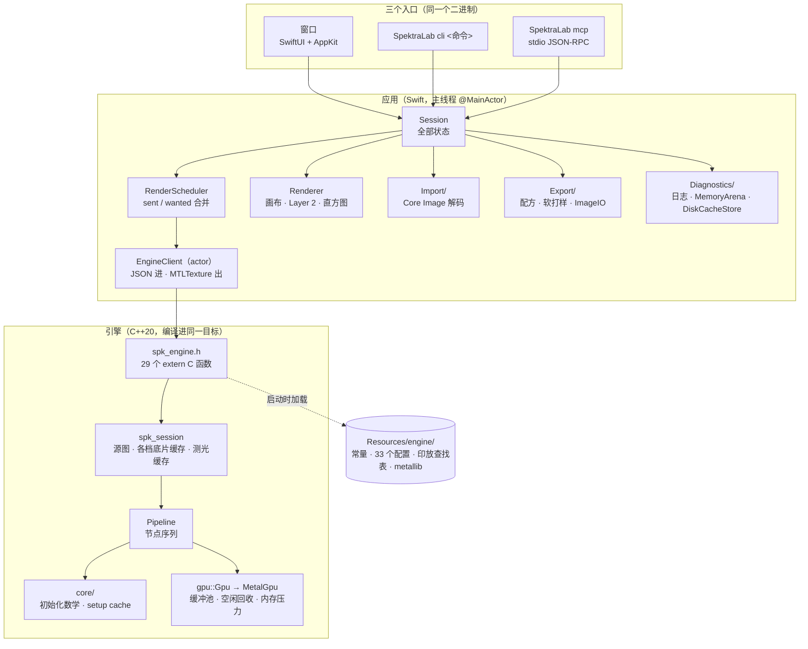

# 02 系统架构

> 用途：说明 SpektraLab 作为一个进程是怎么组成的，依赖哪些系统框架，数据落在哪里，内存和色彩链路的总体规则，以及访问控制。细节分别在 04、05、10、15 展开。

## 1. 整体架构

**只有一个进程。** 应用和 C++ 引擎在同一个 arm64 二进制里，运行时没有管道、子进程和 Python（`ARCHITECTURE.md` §0）。三个入口是窗口、命令行（CLI）和 MCP（Model Context Protocol，模型上下文协议）服务端。



几条贯穿全局的规则：

| 规则 | 含义 | 出处 |
|---|---|---|
| 参数走 JSON，像素不走 | `EngineClient.call` 收发 Codable 类型；渲染走 `EngineClient.render`，因为纹理不能放进 `Decodable` | `ARCHITECTURE.md` §0 |
| 引擎只返回像素，从不写文件 | 所有文件由 `Export/Exporter.swift` 通过 ImageIO 写出 | `ARCHITECTURE.md` §8.8 |
| 三个入口，一套实现 | 窗口、CLI、MCP 驱动同一个 `Session`，写同一个 sidecar | `ARCHITECTURE.md` §7.9 |
| 一切 GPU 工作同步执行 | 引擎的每次 `flush` 都是 `commit` + `waitUntilCompleted` | `engine/src/gpu/metal_gpu.cpp` `flush` |
| 不存在 CPU 后备路径 | 渲染慢不是"退回了 CPU"，因为根本没有 CPU 路径 | `AGENTS.md` 陷阱 18 |

## 2. 外部依赖

| 依赖 | 用途 | 交互方式 |
|---|---|---|
| Metal | 引擎全部计算内核；应用画布绘制、Layer 2 调色、直方图 | 引擎经 metal-cpp 调用；应用直接用 Swift Metal API。两边共用同一个 `MTLDevice` |
| metal-cpp | C++ 访问 Metal 的头文件库 | `engine/third_party/`，`engine/src/gpu/metal_impl.cpp` 是它唯一的实现编译单元 |
| Core Image | RAW 和 TIFF 解码（`CIRAWFilter`） | `Import/ImageDecoder.swift`；解码结果直接渲染进共享 `MTLBuffer` 交给引擎 |
| ImageIO | 写 JPEG/PNG/TIFF，读内嵌预览做缩略图 | `Export/Exporter.swift`、`Import/ThumbnailCache.swift` |
| ColorSync | 把 ProPhoto 画布转换到显示器色彩空间 | 画布 `CAMetalLayer` 打上 ProPhoto 标签，由系统转换（`ARCHITECTURE.md` §7.4） |
| CryptoKit | SHA-256：sidecar 文件名、缓存键、移动文件的指纹 | `Model/Sidecar.swift`、`Diagnostics/DiskCacheStore.swift` |
| libsqlite3（系统库） | 磁盘缓存的索引 | `Diagnostics/DiskCacheStore.swift` |
| CoreText / CoreGraphics | 引擎里把片边字、日期栅格化 | `engine/src/pipeline/overscan.cpp` |
| GitHub Releases API | 检查新版本：`https://api.github.com/repos/JamesQiu2005/SpektraLab/releases/latest` | `Updates/UpdateCheck.swift`；只在用户点击设置里的按钮时请求一次，无认证、不上传本地信息（RFC-021） |
| 上游 spektrafilm（Python） | 一致性校验的参考答案；重新烘焙 `engine/resources/` | **只在开发时**通过 `PYTHONPATH` 使用，运行时不存在（[16](./16-parity.md)） |

没有数据库服务、消息队列、远程渲染服务或账号体系。

## 3. 数据存储

项目没有数据库服务。所有持久数据都是本机文件，**除了导出文件，什么都不写进照片所在的文件夹**（`ARCHITECTURE.md` §7.6）。

### 3.1 落盘位置

| 数据 | 位置 | 格式 | 代码 |
|---|---|---|---|
| 每张照片的编辑（sidecar） | `~/Library/Application Support/SpektraLab/Sidecars/<文件名>-<SHA256(标准化路径) 前 16 位十六进制>.spektra.json` | JSON，整文件重写 | `Model/Sidecar.swift` 第 270–274 行 `key(for:)` |
| 旧版 sidecar | `<照片>.spektra.json`（照片旁边） | 同上 | 仍会读取并迁移（同文件第 412–427 行；陷阱 35） |
| 文件移动后的识别 | 存在 sidecar 里的指纹：文件大小 + 前 64 KB 的 SHA-256（`headDigest`） | — | `Model/Sidecar.swift` 第 322–351 行 |
| 半格双拼 | `…/Sidecars/Pairs/*.spektrapair` | JSON；它的观感是该 URL 对应的普通 sidecar | `Model/HalfFramePair.swift` 第 252 行 |
| 文件夹内排序 | `…/Sidecars/Order/<文件夹名>-<路径 SHA256 前 16 位>.order.json` | JSON | `Model/FrameOrder.swift` |
| 导出配方 | `~/Library/Application Support/SpektraLab/export-recipes.json` | JSON | `Export/ExportRecipe.swift` 第 709–736 行 |
| 磁盘缓存 | `~/Library/Caches/com.hanze.spektralab/store/` | 数据文件 `<摘要前 2 位>/<摘要>.bin` + `index.sqlite` | `Model/Session.swift` 第 993–995 行、`Diagnostics/DiskCacheStore.swift` |
| 会话日志 | `~/Library/Logs/SpektraLab/`（可在设置里改，键 `diag.logDirectory`） | 每次启动一个按行 JSON 文件，`latest.jsonl` 是指向当前文件的符号链接 | `Diagnostics/Diagnostics.swift` 第 394–398 行、`Diagnostics/LogFile.swift` |
| 导出作业日志 | 导出文件旁的 `.joblog.jsonl` | 按行 JSON；**默认关闭**（`diag.writeExportJobLog`） | `Diagnostics/JobLog.swift` |
| 应用设置 | `UserDefaults`：`ui2.*`（界面）、`diag.*`（诊断，共 12 个键） | plist | `Model/Session.swift`（`Session.uiKey = "ui2."`）、`Diagnostics/Diagnostics.swift` 第 402–413 行 |

旧的 `com.hanze.spektrafilm`、`com.hanze.filmify` 缓存目录直接弃用，不迁移，因为里面只有可重建的解码缓存（`Session.swift` 第 989–992 行注释）。

### 3.2 磁盘缓存的 SQLite 索引

`index.sqlite` 有两张表（`Diagnostics/DiskCacheStore.swift` 第 74–98 行）：

| 表 | 列 | 用途 |
|---|---|---|
| `entries` | `key` TEXT 主键、`kind`、`path`、`width`、`height`、`source_width`、`source_height`、`format`、`bytes`、`cost_ms`、`hits`、`priority`、`created_at`、`used_at`；索引 `entries_priority(priority)` | 每个缓存条目一行 |
| `meta` | `key` TEXT 主键、`value` REAL；初始插入 `clock` = 0 | GDSF 的全局时钟 |

- `kind` 取值（`Model/CachePolicy.swift`）：`decode`、`source`、`print_live`、`print_full`。
- 淘汰策略 GDSF（Greedy Dual-Size Frequency，贪心双重大小频率）：`priority = clock + max(1, hits) × cost_ms / (bytes / 1e6)`（`CachePolicy.swift` 第 95–97 行）。重算越贵、命中越多、体积越小的条目越晚被淘汰；每淘汰一条，`clock` 抬到被删条目的优先级。
- 写入顺序：先写完数据文件（`.tmp` 再改名），再写索引行。有行无文件是垃圾；有文件无行在启动时清扫（`garbageCollect`，第 234 行）。
- 默认上限 8000 MB（`Diagnostics.defaultDiskCacheCapMB`，键 `diag.diskCacheCapMB`）。删除缓存只损失速度，不损失任何编辑。

### 3.3 引擎的只读资源

| 资源 | 位置 | 说明 |
|---|---|---|
| 烘焙常量 | `spektrafilm_constants.bin`（约 9.4 MB） | 光谱表、Hanatos 光谱、8 张印放查找表等，由 `engine/tools/bake_resources.py` 生成 |
| 胶片/相纸配置 | `profiles/*.json`：28 个来自 `engine/resources/`，5 个黑白来自 `engine/resources_product/` | 由 `engine/build.sh bundle` 合并进应用包 |
| 印放查找表索引 | `print_luts.json`（8 条） | 表本体在常量文件里 |
| 中性滤色数据 | `neutral_print_filters.json` | 各胶片/相纸组合的中性滤色值 |
| 着色器库 | `spektrafilm.metallib` | 构建产物，不入库 |

应用启动时引擎按固定顺序查找资源目录，见 [05](./05-engine-boundary.md) 第 6 节。

## 4. 缓存与队列汇总

| 名称 | 层 | 内容 | 失效或淘汰 | 详见 |
|---|---|---|---|---|
| setup cache | 引擎 | CAM16 `C_max` 表（按输出色彩空间）、Hanatos `tc_lut`（按感光度，最多 4 个） | 引擎生命周期内保留 | [15](./15-engine-gpu-and-memory.md) |
| 各档底片缓存 | 引擎会话 | live/preview/full 的胶片侧输出 | shoot 层改动或换胶片时丢弃 | [04](./04-render-flow.md) |
| 测光缓存 | 引擎会话 | 七种测光方式的 EV | 输入色彩空间或几何变化时重测 | [04](./04-render-flow.md) |
| 印放查找表缓冲 | 引擎 | 每种相纸一份设备端拷贝 | 引擎生命周期 | [15](./15-engine-gpu-and-memory.md) |
| GPU 缓冲池 | 引擎 | 中间结果缓冲 | 换帧、60 秒空闲、内存压力时回收 | [15](./15-engine-gpu-and-memory.md) |
| `TextureStore` | 应用 | 最近若干帧的打印纹理 | 由 `MemoryArena` 驱逐 | [03](./03-core-modules.md) |
| `DiskCacheStore` | 应用 | 解码结果、成品打印 | GDSF，默认 8000 MB | 本篇 3.2 |
| `PrintWriteback` | 应用 | 等待写入磁盘缓存的打印 | 有界 FIFO，超过 5 亿字节丢最旧的 | [07](./07-scheduled-tasks.md) |
| `RenderScheduler` | 应用 | 用户想要的参数 `wanted` 与引擎已有的 `sent` | 只保留最新一次差异 | [04](./04-render-flow.md) |

## 5. 内存模型概要

来源：`ARCHITECTURE.md` §4，细节见 [15](./15-engine-gpu-and-memory.md)。

- **缓冲只在"空闲且无在途命令"时复用**：句柄全部释放，且最后引用它的命令缓冲已完成。流水线在每个节点后 `flush`。
- **死缓冲会被销毁，而不只是回池**（RFC-020）。102 MP 哈苏原图的峰值在 1.0.3 版从 23 GB 降到 13.7 GB；峰值出在渲染，不在 Core Image。
- **同一时间只有一次全分辨率渲染**。交互渲染在预览长边上做，全分辨率渲染在编辑停下后跑一次。
- **导出一次只处理一帧**，因为两次 100 MP 全分辨率渲染放不进内存。
- **应用台账只记账，不拥有内存**（RFC-019）。`MemoryArena` 登记每块大内存及其驱逐回调，受两个设置约束：给系统留的余量 `diag.memoryReserveMB`（默认 2000 MB），以及应用工作集上限 `diag.memoryCapMB`（默认 min(8192 MB, 物理内存 × 0.4)，可设为 0 表示不限，`Diagnostics.swift` 第 196–201 行）。
- **导出从不放大**：`OutputSize.pixels(for:)` 在原图长边或以上时不重采样。
- **看内存别看 RSS（常驻内存集）**：它看不到 Metal 池。用 `footprint -p <pid>`；正常会话约 75% 的占用是 `IOAccelerator`（GPU 上的像素），代码约 8 MB。

## 6. 色彩链路概要

来源：`ARCHITECTURE.md` §7.5、RFC-018，细节见 [10](./10-physical-model-and-colour.md)。

```
RAW ──Core Image──► 线性 ProPhoto float32 ──► 引擎内部（光谱 → 对数曝光 → 密度 → 印放密度 → 扫描，没有 RGB 空间）
    ──► CAM16-UCS 色域压缩 ──► 引擎输出：ProPhoto RGB，CCTF 编码（工作空间）
    ──► Layer 2 调色 · 曲线 · 几何（仍在 ProPhoto）
    ├─► 画布：图层打 ProPhoto 标签，ColorSync 转到显示器
    ├─► 导出：一次输出变换（CAM16 压进配方色域，再套配方的传递曲线），打标签写出
    └─► 软打样：与导出同一变换，在文件自身分辨率上做
```

- 每个目的地**恰好一次**色彩转换；转换数据（矩阵、CAM16 常数、`C_max` 表）通过 `spk_output_transform` 向引擎取，应用里没有第二套色彩库（`Canvas/ColourManagement.swift`）。
- 应用从 `open` 回复里读取实际的输出色彩空间，不假设（陷阱 28）。
- TIFF 默认导出到 Display P3，会不可逆地损失约 11% 色度；要继续调色的文件应在配方里选 ProPhoto。

## 7. 访问控制与安全

| 方面 | 现状 | 出处 |
|---|---|---|
| 用户认证 | 无。这是单用户桌面应用 | — |
| CLI 与 MCP 入口 | 由开关 `ui2.agentAccess` 控制，**默认关闭**。每次调用都先 `UserDefaults.synchronize()` 再读，不缓存，所以在设置里关掉后下一次调用立即被拒（退出码 2） | `Agent/AgentAccess.swift` 第 12–23 行 |
| 检查点 | 两处：`AgentCLI.run` 启动工作区之前；`AgentTools.call` 每次调用时 | `Agent/AgentTools.swift` |
| 批量导出期间 | 只放行 `get_schema`、`list_stocks`、`list_recipes` 三个只读工具 | `Agent/AgentTools.swift` |
| MCP 传输 | stdio，**协议本身无认证**；唯一的保护是上面的开关。能启动这个可执行文件的本机进程都能驱动它 | `Agent/MCPServer.swift` |
| 安装的命令 | `~/.local/bin/spektralab`，一个 0755 的 sh 脚本，内容是 `exec '<可执行文件>' cli "$@"`；覆盖或卸载时只动带「Installed by Settings ▸ Agents」标记的脚本 | `Agent/AgentAccess.swift` 第 31–74 行；界面在 `Windows/AgentsSettingsPage.swift` |
| 网络 | 唯一的出站请求是用户主动触发的版本检查 | `Updates/UpdateCheck.swift` |
| 用户文件 | 从不改写源照片；导出先写隐藏的 `.partial` 文件再移到正式位置，崩溃不会留下截断文件 | `Export/Exporter.swift`（`ARCHITECTURE.md` §7.8） |

> 安全注意：打开 Agent 开关后，CLI 和 MCP 会按调用方给的路径打开、编辑、导出文件。`AgentWorkspace.open` 只做 `~` 展开和路径标准化（`Agent/AgentWorkspace.swift` 第 52–53 行），没有看到路径白名单。所以 MCP 客户端发起的操作，权限等同于当前用户。
